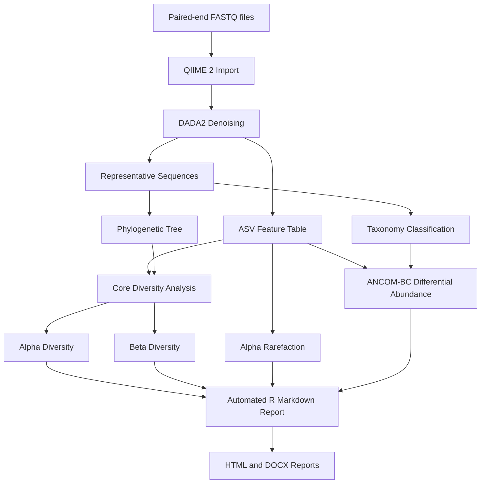

# 16S Amplicon Nextflow Pipeline

A modular and reproducible **16S rRNA amplicon analysis pipeline** built using **Nextflow DSL2** and **QIIME 2**.

**In one sentence:** Transform paired-end 16S sequencing reads into ASVs, taxonomic profiles, alpha and beta diversity results, differential abundance analyses, and automated HTML and DOCX reports.

**Tools:** Nextflow · QIIME 2 · DADA2 · MAFFT · FastTree · ANCOM-BC · R · R Markdown · Singularity/Apptainer

---

## Overview

This pipeline automates the analysis of paired-end 16S rRNA amplicon sequencing data.

The workflow includes:

- Importing paired-end sequencing data into QIIME 2.
- DADA2 denoising and amplicon sequence variant (ASV) generation.
- Phylogenetic tree construction.
- Taxonomic classification using a pretrained QIIME 2 classifier.
- Alpha and beta diversity analysis.
- Alpha diversity group significance testing.
- Alpha rarefaction analysis.
- Differential abundance analysis using ANCOM-BC.
- Automated HTML and DOCX report generation.

**Note:** FastQC and fastp module files are present in the repository but are not currently connected to the main workflow.

## Workflow



## Pipeline modules

| Module | Function |
|---|---|
| `01_demultiplexing.nf` | Imports sequencing data into QIIME 2 |
| `02_denoising.nf` | DADA2 denoising and ASV generation |
| `03_phylogenetic_tree.nf` | Phylogenetic tree construction |
| `04_taxonomy.nf` | Taxonomic classification |
| `05_diversity.nf` | Core alpha and beta diversity metrics |
| `06_alpha_group_significance.nf` | Alpha diversity group comparisons |
| `07_alpha_rarefaction.nf` | Alpha rarefaction curves |
| `08_differential_abundance.nf` | ANCOM-BC differential abundance analysis |
| `10_r_report.nf` | Automated HTML and DOCX report generation |

## Analysis components

### 1. DADA2 denoising and ASV generation

The pipeline uses QIIME 2's DADA2 plugin to process paired-end reads and generate:

- Denoised representative sequences.
- ASV feature table.
- Denoising statistics.

### 2. Phylogenetic tree construction

Representative sequences are used to construct a phylogenetic tree.

The workflow uses phylogenetic analysis tools including MAFFT and FastTree through the relevant QIIME 2 operations.

### 3. Taxonomic classification

Taxonomic classification is performed using a pretrained QIIME 2 classifier.

The classifier should match the amplified 16S region. The example configuration references a SILVA 138 V4 classifier.

### 4. Alpha diversity analysis

The core diversity module calculates:

- Shannon diversity.
- Observed features.
- Pielou's evenness.
- Faith's phylogenetic diversity.

Alpha diversity group comparisons are performed in a separate analysis module.

### 5. Beta diversity analysis

The pipeline calculates four beta diversity distance metrics:

- Bray-Curtis.
- Jaccard.
- Unweighted UniFrac.
- Weighted UniFrac.

Principal Coordinates Analysis (PCoA) is performed on the distance matrices, followed by Emperor visualizations.

### 6. Alpha rarefaction

The alpha rarefaction module generates rarefaction visualizations to examine diversity patterns across sequencing depths.

### 7. Differential abundance analysis

Differential abundance is performed using QIIME 2's ANCOM-BC method.

The current implementation includes:

- ASV-level differential abundance.
- Genus-level analysis using taxonomic collapse at level 6.
- Standard significance visualization with a threshold of 0.05.
- Exploratory visualization with a relaxed threshold of 0.2.

The relaxed threshold is intended for exploration, not formal statistical significance claims.

The current group comparison uses the metadata column `Health_State`.

### 8. Automated R Markdown reporting

The final reporting module collects outputs from the preceding workflow stages and generates:

- `pipeline_report.html`
- `pipeline_report.docx`
- Figures.
- Tables.

The report uses the templates in the `templates/` directory.

The report process waits for the required upstream analysis outputs before generating the final reports.

## Example dataset

The project README identifies the following public dataset as its example dataset:

| Property | Description |
|---|---|
| NCBI BioProject | PRJNA601994 |
| SRA Study | SRP242624 |
| Assay | 16S rRNA amplicon sequencing |
| Target region | V4 |
| Platform | Illumina MiSeq |
| Sample type | Human stool samples |
| Study population | Parkinson's disease and healthy control groups |

Dataset reference: NCBI BioProject PRJNA601994.

Dataset reuse is subject to the original study's terms and data-access conditions.

## Requirements

- Nextflow (DSL2).
- Singularity or Apptainer.
- QIIME 2 container.
- R container with required R packages.
- Compatible pretrained QIIME 2 taxonomy classifier.
- Paired-end FASTQ files.
- Sample manifest and metadata files.

## Quick start

### 1. Clone the repository

```bash
git clone https://github.com/livolo/16s-Amplicon-Nextflow-Pipeline.git

cd 16s-Amplicon-Nextflow-Pipeline
```

### 2. Prepare input files

The pipeline requires:

- `manifest.tsv` — sample IDs and paired-end FASTQ file paths.
- `sample-metadata.tsv` — sample metadata for group comparisons.
- A pretrained QIIME 2 classifier (`.qza`).
- A QIIME 2 Singularity image (`.sif`).
- An R Singularity image (`.sif`).

Example manifest:

```text
sample-id    forward-absolute-filepath    reverse-absolute-filepath
sample1      /path/to/sample1_1.fastq.gz  /path/to/sample1_2.fastq.gz
sample2      /path/to/sample2_1.fastq.gz  /path/to/sample2_2.fastq.gz
```

Ensure that the manifest is tab-separated and that the sample IDs match those in the metadata file.

### 3. Configure parameters

Edit `nextflow.config` or provide parameter overrides when launching the pipeline.

Important parameters include:

| Parameter | Description |
|---|---|
| `manifest` | Input sample manifest |
| `metadata` | Sample metadata file |
| `classifier` | Pretrained taxonomy classifier |
| `outdir` | Output directory |
| `trunc_len_f` | Forward-read truncation length |
| `trunc_len_r` | Reverse-read truncation length |
| `trim_left_f` | Forward-read bases removed from the beginning |
| `trim_left_r` | Reverse-read bases removed from the beginning |
| `sampling_depth` | Sampling depth for core diversity |
| `max_rarefaction_depth` | Maximum alpha rarefaction depth |
| `group_column` | Metadata column used for group comparisons |
| `qiime_container` | QIIME 2 container path |
| `r_container` | R container path |
| `singularity_opts` | Additional Singularity options |

Default values are provided in `nextflow.config`. Select truncation and sampling-depth values based on the characteristics of your own dataset.

### 4. Run the pipeline

```bash
nextflow run main.nf \
    -profile singularity \
    --manifest metadata/manifest.tsv \
    --metadata metadata/sample-metadata.tsv \
    --classifier reference/silva-138-99-515-806-nb-classifier.qza \
    --qiime_container /path/to/qiime2.sif \
    --r_container /path/to/R.sif \
    --outdir results
```

Resume an interrupted execution:

```bash
nextflow run main.nf -profile singularity -resume
```

Validate the resolved Nextflow configuration before execution:

```bash
nextflow config -profile singularity
```

This checks configuration resolution only. It does not verify input files,
container availability, reference databases, or successful pipeline execution.

## Expected output structure

```text
results/
├── imported_data/
├── denoised/
├── phylogeny/
├── taxonomy/
├── diversity/
│   ├── alpha-group-significance/
│   └── alpha-rarefaction/
├── differential-abundance/
├── r_report/
│   ├── pipeline_report.html
│   ├── pipeline_report.docx
│   ├── figures/
│   └── tables/
├── pipeline_report_executionFile.html
├── timeline.html
└── trace.txt
```

The exact output directory names depend on the `publishDir` settings in the individual modules.

## Repository structure

```text
16s-Amplicon-Nextflow-Pipeline/
│
├── main.nf
├── nextflow.config
├── R.def
│
├── modules/
│   ├── 01_demultiplexing.nf
│   ├── 02_denoising.nf
│   ├── 03_phylogenetic_tree.nf
│   ├── 04_taxonomy.nf
│   ├── 05_diversity.nf
│   ├── 06_alpha_group_significance.nf
│   ├── 07_alpha_rarefaction.nf
│   ├── 08_differential_abundance.nf
│   ├── 10_r_report.nf
│   ├── fastqc.nf
│   └── fastp.nf
│
└── templates/
    ├── Report.Rmd
    ├── plots.R
    └── test_report.Rmd
```

The FastQC and fastp files are currently standalone modules and are not invoked by `main.nf`.

Raw sequencing data, intermediate results, container images and Nextflow work directories should be managed separately from the source repository.

## Reproducibility

The workflow uses Nextflow DSL2 to organize analysis stages into modular processes.

Containerized execution helps maintain consistent software environments across systems. Reproducibility also depends on using compatible reference databases, classifiers, container versions, input data and parameters.

Nextflow generates execution reports, a timeline and a trace file to support workflow monitoring and troubleshooting.

## Current pipeline status

**Implemented in the workflow:**

- QIIME 2 data import.
- DADA2 denoising and ASV generation.
- Phylogenetic tree construction.
- Taxonomic classification.
- Alpha and beta diversity.
- Alpha diversity group significance.
- Alpha rarefaction.
- ANCOM-BC differential abundance.
- Automated R Markdown HTML and DOCX report generation.

**Not currently connected to the main workflow:**

- FastQC.
- fastp.

These modules may be integrated into a future version of the workflow.

## Notes and interpretation

- **Study design:** Statistical group comparisons depend on sample size, metadata quality and experimental design.
- **16S resolution:** 16S amplicon sequencing does not always provide reliable species-level identification. Interpretation depends on the amplified region and classifier.
- **Reference database:** The pretrained classifier must be compatible with the target 16S region.
- **Rarefaction:** Sampling depth should be selected after examining sequencing depth distributions and sample retention.
- **Differential abundance:** Interpret ANCOM-BC results using the statistical model, multiple-testing correction and biological context.

## Author

**Kirti Vishwakarma**
M.Sc. Bioinformatics

[LinkedIn](https://www.linkedin.com/in/kirti-vishwakarma-b69bb9229/) · [GitHub](https://github.com/livolo)

## License

This repository contains the analysis workflow and code. Dataset ownership and reuse are subject to the terms of the original data source and associated study.
