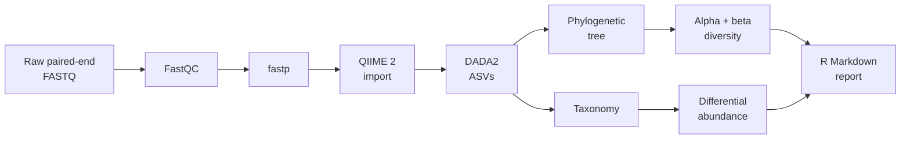

# 16S Amplicon Nextflow Pipeline

A reproducible **16S rRNA amplicon analysis pipeline** built with **Nextflow (DSL2)** and **QIIME 2**.

**In one sentence:** paired-end 16S sequencing reads go in; quality-checked ASVs, taxonomy, diversity results and an automated HTML report come out.

**Tools:** Nextflow · QIIME 2 · DADA2 · FastQC · fastp · R Markdown · Singularity/Apptainer

---

## What it does

- Checks read quality (FastQC) and cleans reads (fastp)
- Builds amplicon sequence variants (ASVs) with DADA2
- Builds a phylogenetic tree and assigns taxonomy (SILVA classifier)
- Calculates alpha and beta diversity, rarefaction curves and group statistics
- Tests for differentially abundant taxa
- Produces one HTML report that brings the results together

## Workflow



## Pipeline modules

| Module | Function |
|---|---|
| `fastqc.nf` | FASTQ quality assessment |
| `fastp.nf` | Read quality filtering and preprocessing |
| `01_demultiplexing.nf` | Import sequencing data into QIIME 2 |
| `02_denoising.nf` | DADA2 denoising and ASV generation |
| `03_phylogenetic_tree.nf` | Alignment and phylogenetic tree (MAFFT + FastTree) |
| `04_taxonomy.nf` | Taxonomic classification |
| `05_diversity.nf` | Core alpha and beta diversity metrics |
| `06_alpha_group_significance.nf` | Alpha diversity group comparisons |
| `07_alpha_rarefaction.nf` | Alpha rarefaction curves |
| `08_differential_abundance.nf` | Differential abundance analysis |
| `10_r_report.nf` | Automated R Markdown report |

## Example dataset

The workflow was developed on a public human gut microbiome dataset.

| Property | Description |
|---|---|
| BioProject | PRJNA601994 (SRA study SRP242624) |
| Assay | 16S rRNA amplicon, V4 region |
| Platform | Illumina MiSeq, paired-end |
| Sample type | Stool (human gut) |
| Study size | 840 individuals: 524 Parkinson's disease, 316 healthy controls |

On this dataset the analysis produced about 620 unique ASVs with an average length of about 252 bp, as expected for a V4 amplicon.

---

## Quick start

**1. Get the code**

```bash
git clone https://github.com/livolo/16s-Amplicon-Nextflow-Pipeline.git
cd 16s-Amplicon-Nextflow-Pipeline
```

**2. Prepare your inputs**

- `manifest.tsv`: sample IDs and FASTQ paths (tab-separated)
- `sample-metadata.tsv`: sample information, including the column used for group comparisons
- A pre-trained QIIME 2 classifier (`.qza`) that matches your 16S region (the example uses SILVA 138, V4)
- A QIIME 2 Singularity image (`.sif`) and an R image built from `R.def`

Example `manifest.tsv`:

```text
sample-id	forward-absolute-filepath	reverse-absolute-filepath
sample1	/path/to/sample1_1.fastq.gz	/path/to/sample1_2.fastq.gz
sample2	/path/to/sample2_1.fastq.gz	/path/to/sample2_2.fastq.gz
```

**3. Run**

```bash
nextflow run main.nf -profile singularity \
  --manifest metadata/manifest.tsv \
  --metadata metadata/sample-metadata.tsv \
  --classifier reference/silva-138-99-515-806-nb-classifier.qza \
  --qiime_container /path/to/qiime2.sif \
  --r_container /path/to/R.sif \
  --outdir results
```

Useful extras:

```bash
-resume      # continue an interrupted run
-stub-run    # quick dry run without running the tools
```

### Parameters

All parameters have defaults in `nextflow.config` and can be changed on the command line.

| Parameter | Meaning |
|---|---|
| `manifest`, `metadata` | Input sample list and sample information |
| `classifier` | Pre-trained taxonomy classifier (`.qza`) |
| `outdir` | Where results are written |
| `trunc_len_f`, `trunc_len_r` | DADA2 truncation length of forward and reverse reads (defaults 145 and 130 suit the example dataset) |
| `trim_left_f`, `trim_left_r` | Bases removed from the start of reads |
| `sampling_depth` | Even sampling depth for core diversity metrics |
| `max_rarefaction_depth` | Maximum depth for rarefaction curves |
| `group_column` | Metadata column used for group comparisons (default `Health_State`) |
| `qiime_container`, `r_container` | Paths to the Singularity images |
| `singularity_opts` | Extra Singularity options, for example `--bind /data` |

Choose `trunc_len_*` and `sampling_depth` from your own data: inspect the read quality plots and the denoising statistics first.

---

## Outputs

```text
results/
├── imported_data/
├── denoised/
├── phylogeny/
├── taxonomy/
├── diversity/
├── differential-abundance/
└── r_report/          # final HTML report
```

The run also writes a Nextflow execution report, timeline and trace file to `results/`.

<!-- Remove this line and the closing line below once the images exist in docs/figures/

## Example results

Output from the example dataset.

**Alpha diversity**


**Beta diversity (PCoA)**


**Taxonomic composition**


Remove this line too -->

## Repository structure

```text
.
├── main.nf                # workflow entry point
├── nextflow.config        # parameters and resources
├── R.def                  # recipe for the R report container
├── modules/               # one Nextflow module per analysis step
└── templates/             # R Markdown report templates and plotting code
```

Raw reads, intermediate files, QIIME 2 artifacts, containers and Nextflow work directories are not stored in the repository.

## Notes

- **Study design:** group tests such as differential abundance, group significance and PERMANOVA are only meaningful when the sample size and design support them.
- **16S resolution:** 16S amplicons give reliable genus-level profiles but not always species-level ones. Interpret species assignments with the classifier confidence and the targeted region in mind.
- **Reference data:** the classifier must match the amplified 16S region.

## Reproducibility

Nextflow keeps each step as a separate, versioned process, and the tools run inside containers, so the same inputs and parameters give the same results on another machine.

## Dataset reference

NCBI BioProject **PRJNA601994** · SRA Study **SRP242624**. Dataset ownership and reuse follow the terms of the original data source and study.

## Author

**Kirti Vishwakarma**, M.Sc. Bioinformatics
[LinkedIn](https://www.linkedin.com/in/kirti-vishwakarma-b69bb9229/) · [GitHub](https://github.com/livolo)

## License

This repository contains the analysis workflow and code. Dataset ownership and reuse are subject to the terms of the original data source and associated study.
